# Heart Disease Risk Prediction: End-to-End MLOps Pipeline


A machine learning classifier that predicts the risk of heart disease from patient health data, built and shipped with modern MLOps practice: reproducible training, experiment tracking, automated tests and security scans, a container image, a Kubernetes deployment on AWS EKS, and live monitoring with Prometheus and Grafana.

> **Course:** BITS Pilani M.Tech AIML (WILP), Machine Learning Operations (MLOps) AIMLCZG523, Assignment 01.
> **Note:** this model is an academic exercise on a small public dataset. It is not a clinical tool.

## Contents

1. [Results at a glance](#results-at-a-glance)
2. [Architecture](#architecture)
3. [Repository structure](#repository-structure)
4. [Quick start](#quick-start)
5. [Data and exploratory analysis](#data-and-exploratory-analysis)
6. [Modelling](#modelling)
7. [Experiment tracking](#experiment-tracking)
8. [API reference](#api-reference)
9. [Testing](#testing)
10. [Docker](#docker)
11. [CI/CD pipeline](#cicd-pipeline)
12. [Kubernetes deployment on EKS](#kubernetes-deployment-on-eks)
13. [Monitoring and logging](#monitoring-and-logging)
14. [Security scanning](#security-scanning)
15. [Evidence](#evidence)
16. [Troubleshooting](#troubleshooting)
17. [Limitations and future work](#limitations-and-future-work)
18. [Deliverables checklist](#deliverables-checklist)

## Results at a glance

| | Logistic Regression (selected) | Random Forest |
|---|---|---|
| CV ROC-AUC (5-fold) | 0.902 | 0.902 |
| Test accuracy | 0.885 | 0.869 |
| Test precision | 0.839 | 0.833 |
| Test recall | **0.929** | 0.893 |
| Test ROC-AUC | **0.966** | 0.948 |

Logistic Regression was chosen for its higher test recall (a missed patient is the costly error in screening), calibrated probabilities for the API's confidence value, and simplicity. The test split has only 61 patients, so the gap between the models is within noise; see [Modelling](#modelling).

| Item | Value |
|---|---|
| Code repository | https://github.com/Rengaprakash4440/AIMLCZG523_Assignment_01 |
| Report | `report/` (PDF or DOCX) |
| Pipeline video | _paste link_ |
| Deployed API | _paste ELB URL while running; the cluster is deleted after evidence is captured to avoid cost_ |

## Architecture

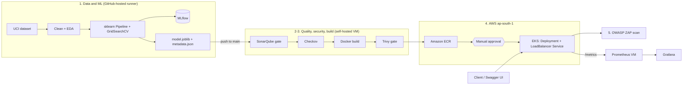

Training and serving share one fitted scikit-learn `Pipeline` (imputation, scaling, encoding and classifier in a single object), so the API applies exactly the transformations used in training.

## Repository structure

```
.
├── .github/workflows/
│   ├── MLOps_pipeline.yaml     # orchestrator: calls the five stage workflows in order
│   ├── ml_pipeline.yml         # stage 1: lint, tests, dataset, EDA, training, MLflow, reproducibility
│   ├── sonarqube.yaml          # stage 2: SonarQube + Checkov
│   ├── docker-image.yml        # stage 3: Docker build, Trivy gate, ECR push
│   ├── kubernetes.yaml         # stage 4: approval, EKS rollout, smoke test, rollback
│   └── zap.yml                 # stage 5: OWASP ZAP API + baseline scans
├── data/
│   ├── heart_raw.csv           # as downloaded from UCI
│   └── heart_clean.csv         # cleaned, binary target
├── dockerfiles/
│   └── Dockerfile              # non-root, health-checked API image
├── kubernetes/
│   ├── namespaces.yaml
│   ├── deployment.yaml         # replicas, probes, limits, hardened securityContext
│   ├── service.yaml            # type LoadBalancer
│   └── network-policy.yaml
├── models/
│   ├── model.joblib            # full fitted pipeline
│   ├── metadata.json           # features, best params, test metrics
│   └── gridsearch_*.csv        # tuning results per model
├── monitoring/
│   ├── heart-api-dashboard.json   # Grafana dashboard (import this)
│   ├── prometheus-values.yaml     # Helm values (in-cluster option)
│   └── grafana-values.yaml
├── report/
│   ├── figures/                # EDA, ROC and confusion-matrix plots
│   └── notebooks/01_eda.ipynb
├── screenshots/                # evidence for the report
├── src/
│   ├── download_data.py        # fetches the UCI dataset (id 45)
│   ├── data.py                 # loading, cleaning, feature lists
│   ├── features.py             # ColumnTransformer preprocessing
│   ├── train.py                # training, tuning, MLflow logging
│   └── app.py                  # FastAPI service with metrics and logging
├── tests/                      # 22 pytest tests
├── requirements.txt            # development and CI dependencies
├── requirements-api.txt        # pinned runtime dependencies for the image
├── sonar-project.properties
├── pytest.ini
└── .flake8
```

## Quick start

**Prerequisites:** Python 3.14 (matches the container, so the pickled model loads identically), Git and Docker. The cloud steps also need the AWS CLI, `kubectl` and an AWS account.

```bash
git clone https://github.com/Rengaprakash4440/AIMLCZG523_Assignment_01.git
cd AIMLCZG523_Assignment_01
python3 -m venv .venv && source .venv/bin/activate
pip install -r requirements.txt

# 1. Get and clean the data (the cleaned CSV is also committed)
python -m src.download_data
python -c "from src.data import load_clean; load_clean().to_csv('data/heart_clean.csv', index=False)"

# 2. Check the code
pytest -v
flake8 src tests

# 3. Train both models (logs to MLflow, writes models/)
python -m src.train

# 4. Browse experiments
mlflow ui --backend-store-uri sqlite:///mlflow.db        # http://127.0.0.1:5000

# 5. Serve the model
uvicorn src.app:app --port 8000                           # http://127.0.0.1:8000/docs
```

Run every command from the project root. All scripts work from a clean clone using only `requirements.txt`.

## Data and exploratory analysis

- **Source:** UCI Heart Disease dataset (id 45), downloaded by `src/download_data.py` with `ucimlrepo`.
- **Cleaning:** the target `num` (0 to 4) is binarised to 0 (no disease) and 1 (disease); duplicates are dropped. The result is 303 patients, 13 predictors (5 numeric, 8 categorical) and a binary target (164 negative, 139 positive).
- **Missing values:** only `ca` (4) and `thal` (2). They are left in the CSV and imputed inside the pipeline so that no statistic leaks from validation data.

Key findings from `report/notebooks/01_eda.ipynb`:

- Classes are nearly balanced (54% / 46%), so no resampling is needed.
- The strongest correlations with the target are `thal` (0.53), `ca` (0.46), `exang` (0.43), `oldpeak` (0.42), `thalach` (-0.42) and `cp` (0.41).
- Asymptomatic chest pain (`cp` = 4) has a 73% disease rate against 18% to 30% for other types.
- `fbs` (0.03) and `chol` (0.09) carry little linear signal; four cholesterol values above 400 were kept.

| Class balance | Correlation heatmap |
|---|---|
| 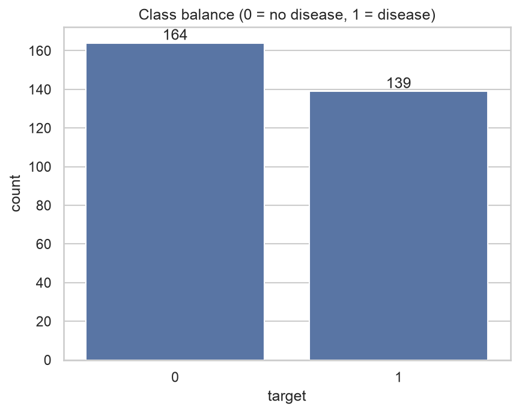 | 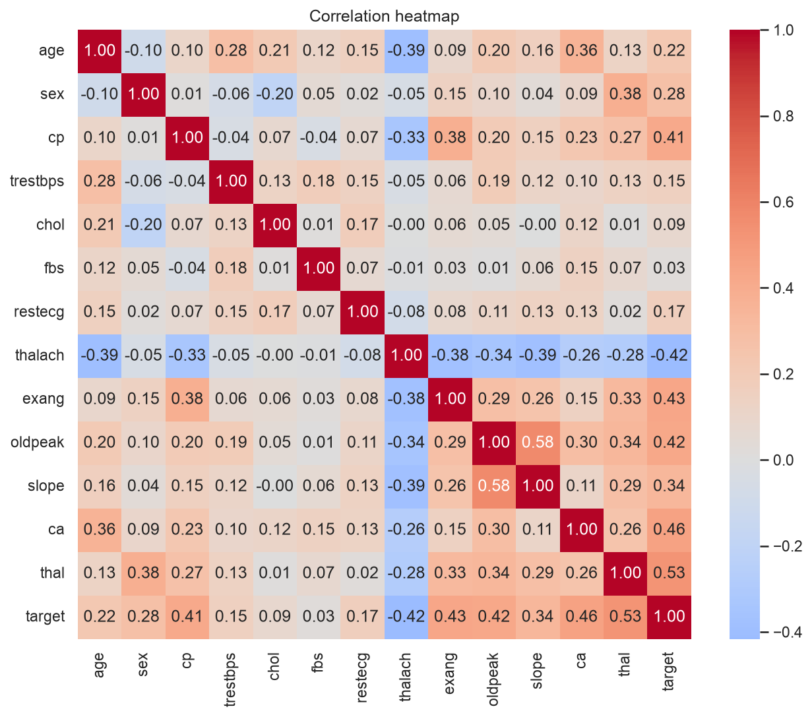 |

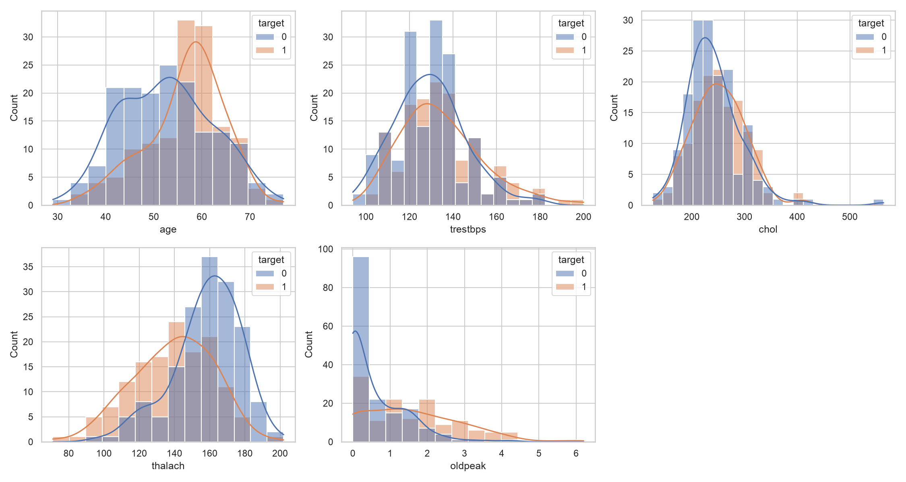

## Modelling

- **Preprocessing** (`src/features.py`): numeric columns use median imputation then standard scaling; categorical columns use most-frequent imputation then one-hot encoding with `handle_unknown="ignore"`.
- **Protocol** (`src/train.py`): stratified 80/20 split (242 train, 61 test, seed 42); `GridSearchCV` with 5-fold stratified cross-validation, refit on ROC-AUC. The test split is used once, for the final report.
- **Search spaces:** Logistic Regression `C` in {0.01, 0.1, 1, 10}; Random Forest `n_estimators` {100, 300} x `max_depth` {None, 5, 10} x `min_samples_leaf` {1, 3}.
- **Best parameters:** Logistic Regression `C = 1`; Random Forest `n_estimators = 100`, `max_depth = 5`, `min_samples_leaf = 3`.

| ROC (Logistic Regression) | Confusion matrix (Logistic Regression) |
|---|---|
| 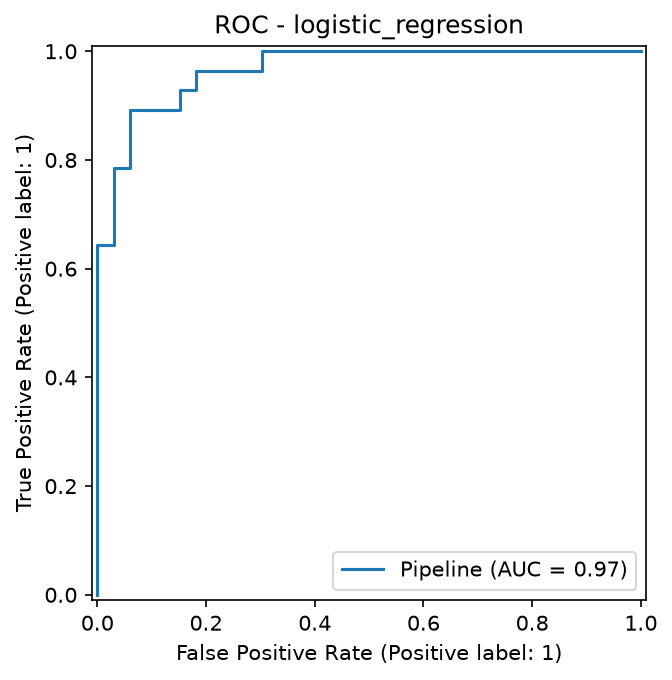 | 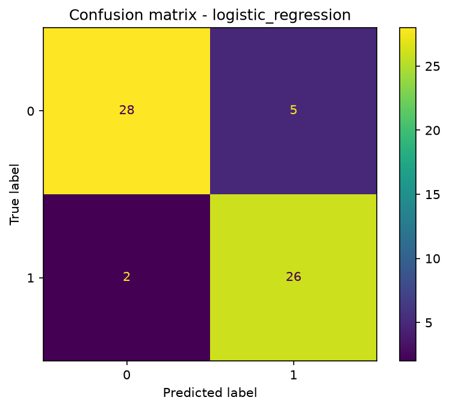 |

**Caution:** with 61 test patients, one prediction moves accuracy by about 1.6 points. The two models are statistically close; Logistic Regression is preferred on recall, probability quality and simplicity, not on a decisive accuracy margin.

## Experiment tracking

MLflow (`sqlite:///mlflow.db`, experiment `heart-disease`) records one run per model:

| Category | Logged |
|---|---|
| Parameters | model, CV folds, seed, test size, best hyperparameters |
| Metrics | `cv_*` (accuracy, precision, recall, roc_auc) and `test_*` (accuracy, precision, recall, f1, roc_auc) |
| Artifacts | ROC and confusion-matrix plots, grid-search CSV, dataset snapshot |
| Model | full fitted pipeline, serialised with cloudpickle |

The database is created at run time and is gitignored; the CI run archives it as an artifact.

## API reference

Base URL: `http://localhost:8000` locally, or the load balancer hostname when deployed.

| Endpoint | Description |
|---|---|
| `POST /predict` | returns the prediction and its confidence |
| `GET /health` | liveness and readiness check |
| `GET /metrics` | Prometheus metrics |
| `GET /docs` | interactive Swagger UI |

**Request**

```bash
curl -X POST http://localhost:8000/predict \
  -H "Content-Type: application/json" \
  -d '{"age":67,"sex":1,"cp":4,"trestbps":160,"chol":286,"fbs":0,"restecg":2,
       "thalach":108,"exang":1,"oldpeak":1.5,"slope":2,"ca":3,"thal":3}'
```

**Response fields**

| Field | Meaning |
|---|---|
| `prediction` | 1 = heart disease, 0 = none |
| `label` | `"heart disease"` or `"no heart disease"` |
| `confidence` | probability of the predicted class |
| `probability_disease` | probability of class 1 |

**Input fields and accepted ranges** (anything outside returns HTTP 422)

| Field | Range | Notes |
|---|---|---|
| `age` | 1 to 120 | years |
| `sex` | 0 or 1 | 1 = male |
| `cp` | 1 to 4 | chest pain type |
| `trestbps` | 50 to 260 | resting blood pressure |
| `chol` | 80 to 700 | serum cholesterol |
| `fbs` | 0 or 1 | fasting blood sugar > 120 |
| `restecg` | 0 to 2 | resting ECG result |
| `thalach` | 40 to 250 | maximum heart rate |
| `exang` | 0 or 1 | exercise-induced angina |
| `oldpeak` | 0 to 10 | ST depression |
| `slope` | 1 to 3 | ST segment slope |
| `ca` | 0 to 4, optional | vessels coloured; imputed if omitted |
| `thal` | optional | 3, 6 or 7; imputed if omitted |

## Testing

```bash
pytest -v           # 22 tests with coverage, run on synthetic data (no MLflow or real model needed)
flake8 src tests    # lint
```

`pytest-cov` reports 98% line coverage of `src/` (193 statements, 4 missed); the coverage report is passed to SonarQube in the pipeline.

| File | Tests | Covers |
|---|---|---|
| `tests/test_data.py` | 4 | target binarisation, duplicate removal, feature lists, cleaned-data schema |
| `tests/test_features.py` | 3 | no missing values after preprocessing, scaling, unseen categories |
| `tests/test_model.py` | 4 | valid probabilities, missing inputs at inference, save/load round trip, beats chance |
| `tests/test_api.py` | 6 | health, prediction and confidence, optional fields, range validation, required fields, metrics |
| `tests/test_download_data.py`, `tests/test_train.py` | 5 | download script and training entry point |

## Docker

```bash
docker build -f dockerfiles/Dockerfile -t heart-api:1.0 .
docker run -d --name heart-api -p 8000:8000 heart-api:1.0
curl http://localhost:8000/health
docker logs heart-api
docker ps          # STATUS shows (healthy) after about 30 seconds
```

The image uses `python:3.14-slim`, installs only `requirements-api.txt`, runs as a non-root user and defines a `HEALTHCHECK` on `/health`. The `PYTHON_VERSION` build argument must match the version used for training.

## CI/CD pipeline

`MLOps_pipeline.yaml` is the orchestrator. It calls five reusable workflows in order, and each stage depends on the one before it. Pull requests run stage 1 only; stages 2 to 5 run on pushes to `main` or manual dispatch.

| Stage | Workflow | Runner | What it does | Fails when |
|---|---|---|---|---|
| 1 ML pipeline | `ml_pipeline.yml` | GitHub-hosted | flake8, pytest, dataset re-creation, EDA notebook run, training with MLflow, model comparison, two-run reproducibility check | lint or test error, notebook error, data or results differ between runs |
| 2 Quality and security | `sonarqube.yaml` | self-hosted VM | SonarQube scan and quality gate, Checkov on Dockerfile and manifests | quality gate or policy failure |
| 3 Build | `docker-image.yml` | self-hosted VM | Docker build, Trivy scan, push to ECR tagged with the commit SHA | HIGH or CRITICAL fixable vulnerabilities |
| 4 Deploy | `kubernetes.yaml` | self-hosted VM | manual approval, `kubectl apply`, rollout wait, `/health` smoke test, auto rollback | approval rejected, rollout timeout, failed smoke test |
| 5 ZAP | `zap.yml` | self-hosted VM | OWASP ZAP API scan from `/openapi.json` plus passive baseline scan | high-risk alert found |

Every stage uploads its evidence as a run artifact (test reports, models, figures, MLflow database, Trivy and ZAP reports), found at the bottom of each run page in the **Actions** tab.

**Running a single stage:** each stage workflow also supports manual dispatch (Actions, choose the workflow, Run workflow). `kubernetes.yaml` asks for a full ECR image URI and `zap.yml` asks for the API base URL.

**One-time setup**

1. Add the repository variable `SONAR_SECRET_ARN` (Settings, Secrets and variables, Actions, Variables), pointing to the Secrets Manager secret that holds the SonarQube token and host.
2. Register the VM as a self-hosted runner (Settings, Actions, Runners) and install Docker, Trivy, Checkov, the AWS CLI and `kubectl` on it.
3. Give the VM an IAM instance profile with ECR push, `eks:DescribeCluster` and Secrets Manager read access, and add that role to the cluster with an EKS access entry. No AWS keys are stored in GitHub.
4. Create the GitHub environment `production` with a required reviewer (Settings, Environments). The deploy stage pauses there until someone approves.

## Kubernetes deployment on EKS

Manifests live in `kubernetes/`. The pipeline deploys automatically; the manual route is below.

```bash
export AWS_REGION=ap-south-1
export ACCOUNT_ID=$(aws sts get-caller-identity --query Account --output text)
export ECR=$ACCOUNT_ID.dkr.ecr.$AWS_REGION.amazonaws.com

# Image to ECR (build for x86 if you are on an Apple Silicon Mac)
aws ecr create-repository --repository-name heart-api --region $AWS_REGION
aws ecr get-login-password --region $AWS_REGION | docker login --username AWS --password-stdin $ECR
docker buildx build --platform linux/amd64 -f dockerfiles/Dockerfile -t $ECR/heart-api:1.0 --push .

# Cluster (use an instance type your account allows; c7i-flex.large was used here)
eksctl create cluster --name heart-mlops --region $AWS_REGION \
  --nodegroup-name workers --node-type c7i-flex.large --nodes 1 --managed

# Deploy
kubectl apply -f kubernetes/namespaces.yaml
sed "s|image: .*|image: $ECR/heart-api:1.0|" kubernetes/deployment.yaml | kubectl apply -f -
kubectl apply -f kubernetes/service.yaml -f kubernetes/network-policy.yaml
kubectl -n heartbeat-api rollout status deployment/heart-api

# Public endpoint
export URL=$(kubectl -n heartbeat-api get svc heart-api -o jsonpath='{.status.loadBalancer.ingress[0].hostname}')
curl http://$URL/health
```

**What the manifests set up:** namespace `heartbeat-api`; several replicas (five were running when the evidence was captured) with readiness and liveness probes on `/health`; CPU and memory requests and limits; a hardened security context (non-root user, read-only root filesystem, no privilege escalation, all capabilities dropped, no service account token); a `LoadBalancer` service on port 80; and a network policy.

> **Cost:** an EKS cluster bills by the hour. Delete it as soon as the screenshots and video are captured:
> ```bash
> eksctl delete cluster --name heart-mlops --region ap-south-1
> aws ecr delete-repository --repository-name heart-api --force --region ap-south-1
> ```
> Then check the console for leftover load balancers and node groups.

## Monitoring and logging

**Logging:** a middleware logs every request (method, path, status, latency in ms) and every prediction (class and confidence). Read them with `kubectl -n heartbeat-api logs -l app=heart-api` or `docker logs heart-api`.

**Metrics** exposed at `/metrics`:

| Metric | Type | Labels |
|---|---|---|
| `api_requests_total` | counter | method, endpoint, status |
| `api_request_latency_seconds` | histogram | endpoint |
| `predictions_total` | counter | label |
| model-level metrics | gauges, histograms | hold-out test metrics, predicted-probability distribution, mean confidence, inference latency, share of positive predictions, mean of key inputs (drift check) |

**Prometheus and Grafana** run on a separate VM so monitoring survives a cluster rebuild. Add this job to `prometheus.yml`:

```yaml
scrape_configs:
  - job_name: heart-api
    metrics_path: /metrics
    scrape_interval: 15s
    static_configs:
      - targets: ["<ELB-HOSTNAME>:80"]
```

In Grafana, add Prometheus as a data source, then **Dashboards, New, Import** and upload `monitoring/heart-api-dashboard.json`. Panels: request rate by endpoint, p95 latency, error rate (4xx and 5xx), predictions by class, hold-out model metrics, predicted-probability distribution, mean confidence, inference latency, share of positive predictions and a mean-of-inputs drift check.

Helm values in `monitoring/` allow an in-cluster installation instead (`prometheus-values.yaml`, `grafana-values.yaml`). Because the VM scrapes through the load balancer, use a single replica for demonstrations; with more, each scrape lands on a random pod and per-pod counters interleave.

## Security scanning

| Tool | Scans | Gate |
|---|---|---|
| SonarQube | Python source (`src/`) for bugs, smells and vulnerabilities | quality gate |
| Checkov | Dockerfile and Kubernetes manifests against policy checks | any failed check |
| Trivy | built image for HIGH and CRITICAL OS and package vulnerabilities | exit code 1 on fixable findings, so a vulnerable image is never pushed |
| OWASP ZAP | the live endpoint: API scan from the OpenAPI definition and a passive baseline scan | high-risk alerts |

Reports are uploaded as run artifacts. Accepted findings should be documented in the report with a reason rather than silently skipped.

## Evidence

Screenshots from the finished pipeline and deployment (also used in the report).

**MLflow runs with cross-validation and test metrics**

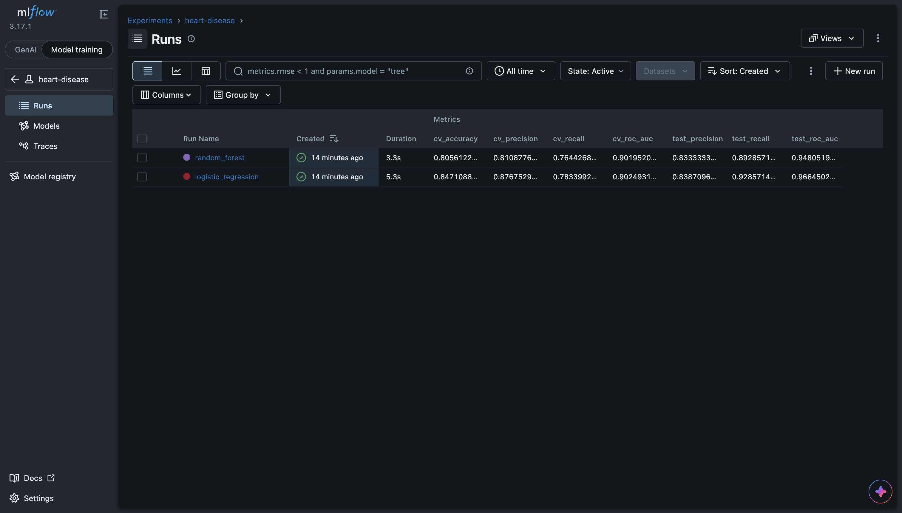

**MLflow comparison of the two runs**

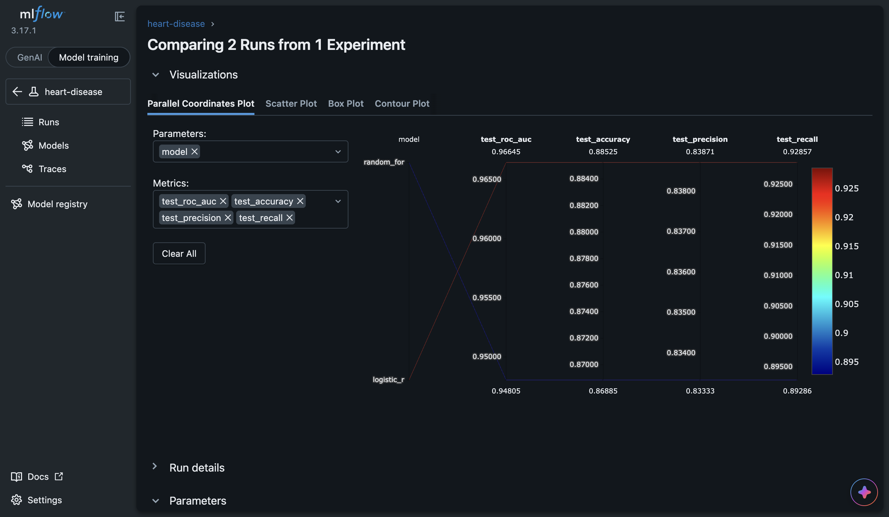

**Artifacts logged with a run**

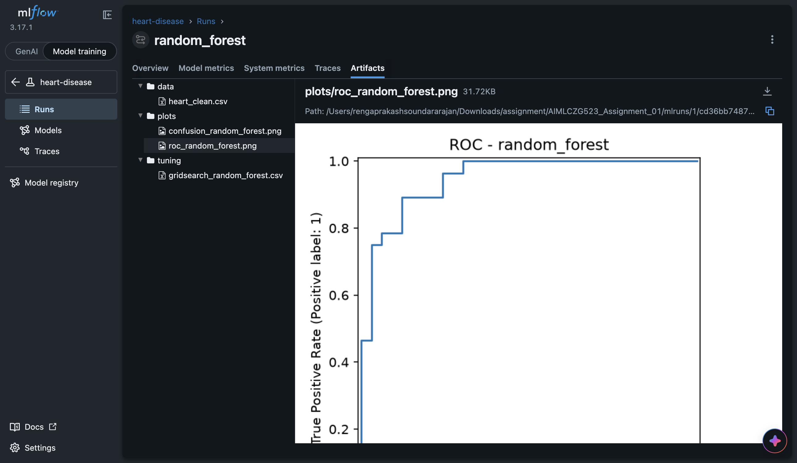

**pytest summary and coverage (22 passed)**

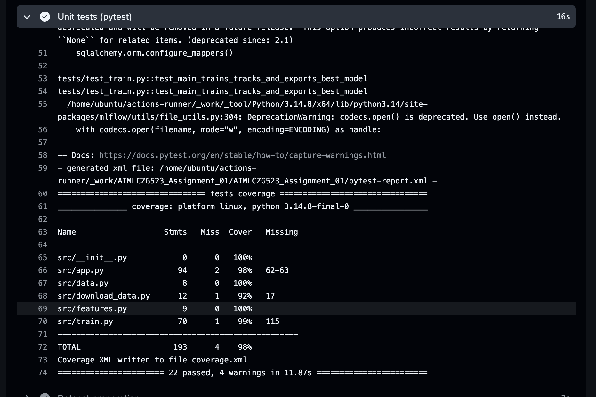

**Pipeline run: five stages**

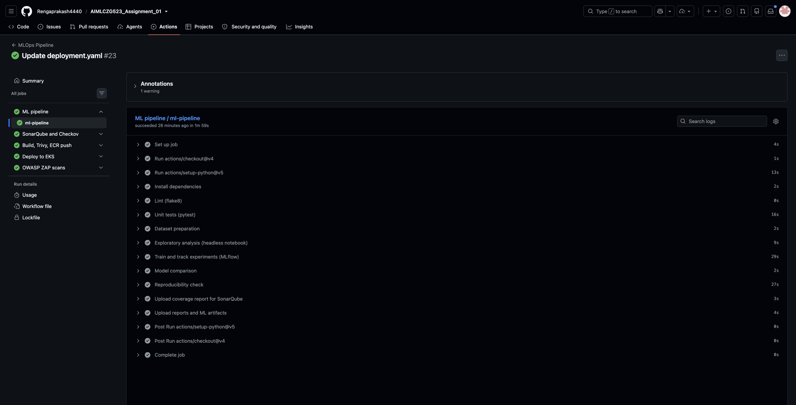

**Manual approval before deployment**

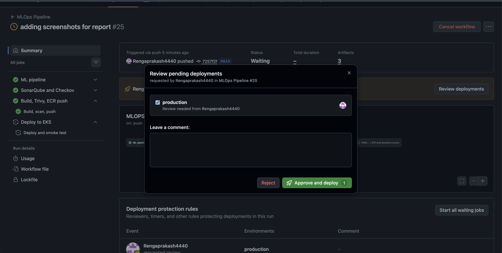

**SonarQube quality gate: Passed**

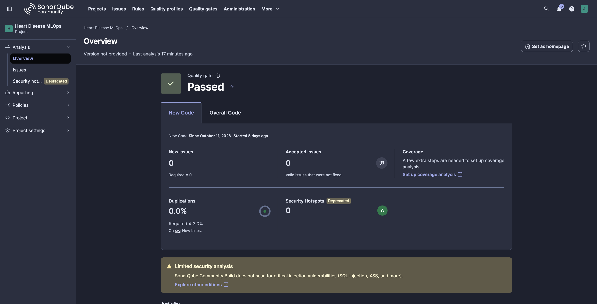

**Checkov scan of the Dockerfile**

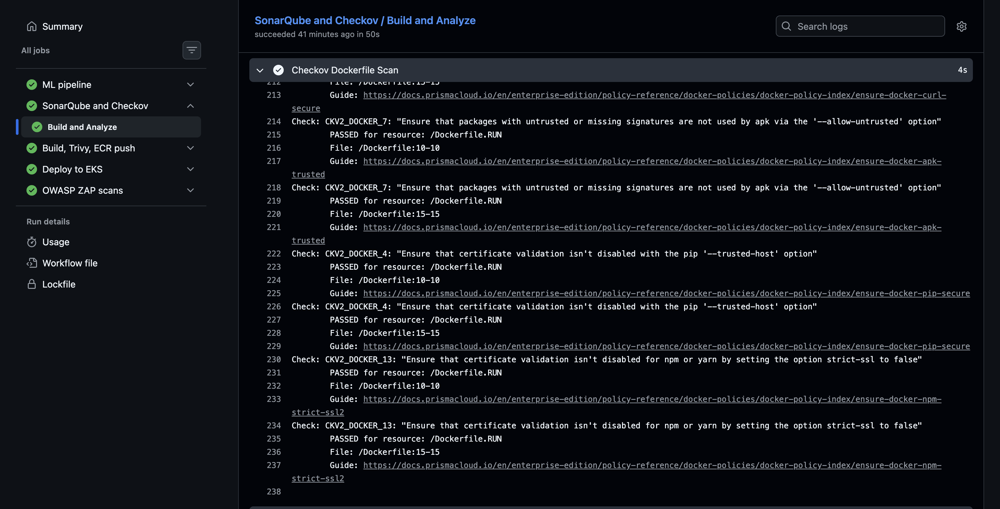

**Checkov scan of the Kubernetes manifests**

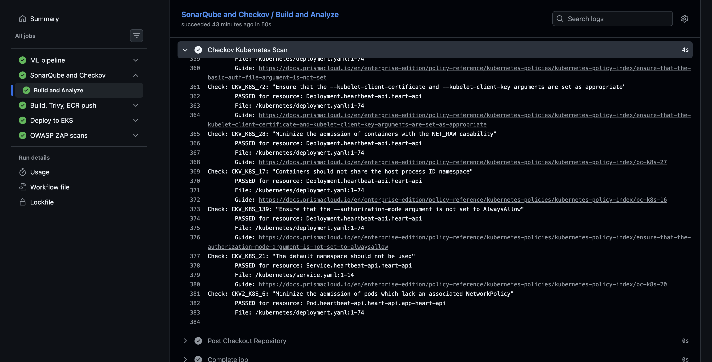

**OWASP ZAP report: 0 high, 0 medium, 2 low, 2 informational**

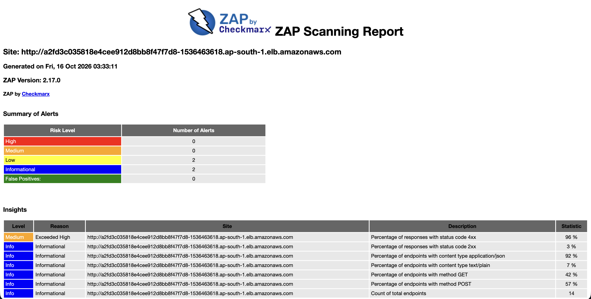

**Docker build step in the pipeline**

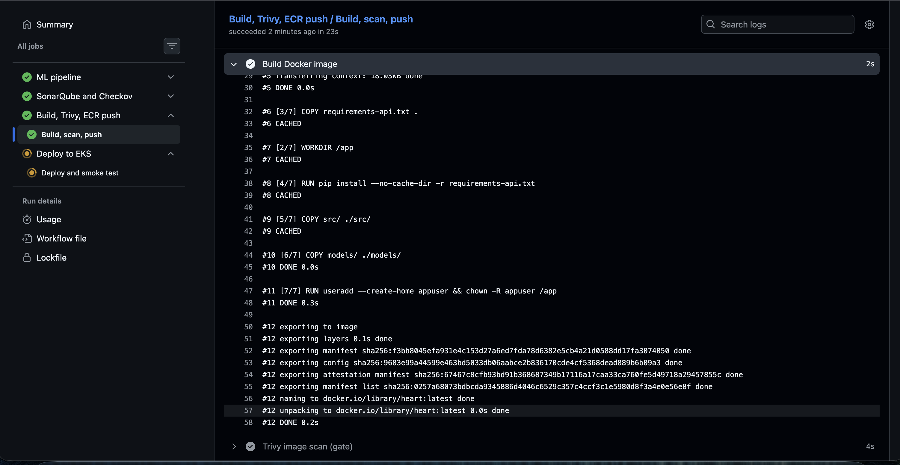

**Nodes, pods and LoadBalancer service on EKS**


**Public endpoint test: /health and /predict**

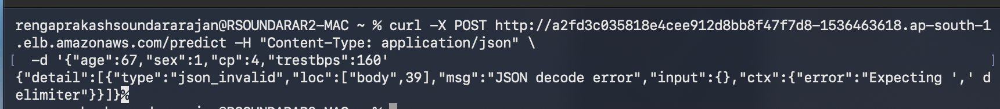

**EKS cluster Active in the AWS console**

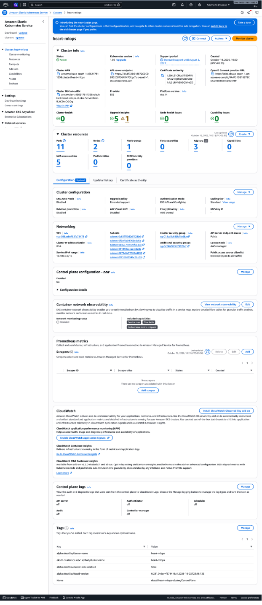

**API request logs**

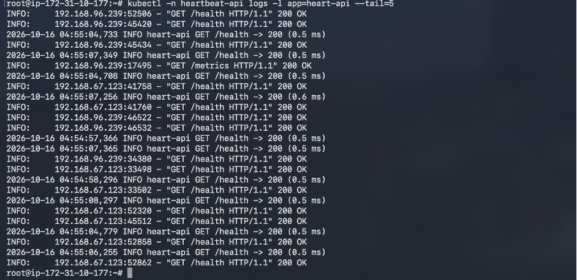

**Prometheus query returning API counters**


**Grafana dashboard**

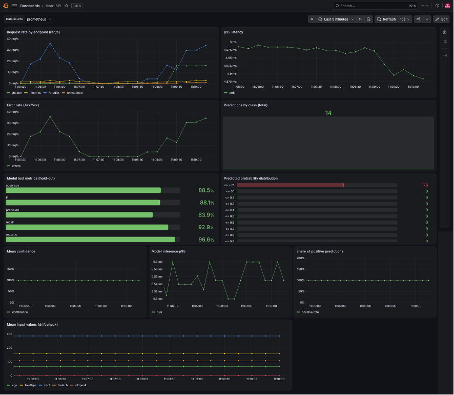

_Trivy scan of the built image: 


## Troubleshooting

| Symptom | Likely cause and fix |
|---|---|
| `ModuleNotFoundError: No module named 'src'` | run commands from the project root; in the notebook, the first cell locates the root automatically |
| MLflow fails with an untrusted-types (`skops`) error | log the model with `serialization_format="cloudpickle"` (already set in `src/train.py`) |
| Model fails to load in the container | the container Python version differs from the training version; set the `PYTHON_VERSION` build argument to match |
| EKS node group fails to create | the account may not allow the chosen instance type; list allowed types and pick another |
| `curl: Could not resolve host` on a new ELB | wait a few minutes for DNS, then retry; check `kubectl get endpoints` |
| `workflows must be defined at the top level` | reusable workflows must sit directly in `.github/workflows/`, not in a subfolder |
| `no version specified` for a `uses:` line | local reusable workflow paths must start with `./.github/workflows/` and match the filename exactly |
| `kubectl` returns Unauthorized in CI | add the runner's IAM role to the cluster with an EKS access entry |

## Limitations and future work

- The dataset has 303 patients, so metrics carry wide uncertainty and the model is not a clinical tool.
- The API has no authentication or rate limiting, and the load balancer serves plain HTTP. Next steps: an API key and an ACM certificate.
- Drift monitoring is basic: the dashboard tracks the mean of key inputs, but there is no statistical drift test or alerting. The model is baked into the image rather than pulled from a registry.
- Small cluster; in-cluster scraping and autoscaling would be the production approach.

## Deliverables checklist

| Brief item | Where |
|---|---|
| Code, Dockerfile, requirements | `src/`, `dockerfiles/`, `requirements*.txt` |
| Cleaned dataset and download script | `data/`, `src/download_data.py` |
| Notebooks and scripts (EDA, training, inference) | `report/notebooks/01_eda.ipynb`, `src/train.py`, `src/app.py` |
| Unit tests | `tests/` |
| GitHub Actions workflows | `.github/workflows/` |
| Deployment manifests | `kubernetes/` |
| Monitoring configuration | `monitoring/` |
| Screenshots | `screenshots/` |
| Written report (about 10 pages) | `report/` |
| Deployed API URL or access instructions | [Results at a glance](#results-at-a-glance), [Kubernetes deployment on EKS](#kubernetes-deployment-on-eks) |
| Short pipeline video | link in [Results at a glance](#results-at-a-glance) |

## Author

Rengaprakash S, 2025ae05107
